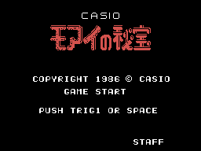
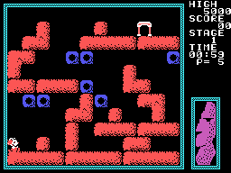
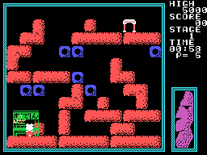

# Curiosities

## The stage select

When a game starts, the game looks at the keyboard (`fase_empieza`, 0x82FD): with **two keys** held, it starts in
another stage. A or B with 0 or 5 give stages 0, 5, 12 and 18 (A with 0, the first; B with 5, number 18); Z, Y, X,
W or V with a letter from C to R pick from the table at 0x83B9. Recorded in openMSX: with B and 5 held while pressing
the space bar, the game starts in stage 18 of the game, which the scoreboard calls STAGE 15 (the BONUS stages are not
counted).

## SELECT and ESC on the title

With **SELECT** held on the title (0xE023 = 1), neither the rocks, nor the enemies, nor the time take lives; F1 does
(`tocado`, 0x899E). The code lets one case through, 0x80 in 0xE183, but nobody ever writes that value: only 0xFF, 1
and 0.

With **ESC** (`titulo`, 0x80BC), the high score becomes 5000 (0xE032 = 0x50) and 0xE039 becomes 2; nobody reads that
0xE039. In other Casio cartridges of the same time, the same key in the same place is used to continue.

## STOP to look around

While **STOP** is held, the game stops and lets you look: a frame surrounds the hero and the joystick moves the view
up and down (`mirar`, 0x8778); on release, the view goes back by itself (`mirar_vuelve`). **F1** takes a life
(`muere`, 0x89B2).

## The scoreboard misses a text

The scoreboard paints HIGH, SCORE and STAGE with the same routine (`marcador_pon`, 0x928D); next came a six-tile
text, "     0", on the score row (0x92DF), which in other Casio games is the fixed 0 after the digits. But the
instruction that should point DE at it loads HL (`ld hl,092dfh`, 0x92AB), so it is written from the 0xFF where STAGE
ended: nothing. The score comes out without the 0 after it.

## The points for crushed enemies

A rock that falls on an enemy makes it explode and gives the points of its type from the table at 0x99F3 (500, 300,
300, 100, 100, 100). But the type is read with bit 7 set (every routine sets it when it starts), so the game does
not read the table but the bytes from 0x9A74 to 0x9A7D, which are code (`aplastado_objeto`, 0x99CE). The code says
so; in the recordings on this site no enemy was crushed, so we have not seen it on screen.

## Unused texts

- **GOOD LUCK TO NEXT STAGE** (0x8D63), after the stage-over texts: no call writes it.
- **FLOOR** (0x92E6), among the scoreboard ones: nor that one.
- **PUSH TR1 TO START** (0x8619) is stuck to P=, and the routine stops before reaching it.
- The title's name is there twice (0x543D and 0x547D), the second with the tiles in another order; only the first is
  read.

## Code nobody calls

- Up does nothing: the routine that picked up a laid block (0x9F1A) was left without a call.
- At 0xAFA7, the interrupt jumps over a piece that split a demo button between two variables (0xE020 and 0xE022).
- `espera_256` (0xAE31) sets HL = 0xE000 and BC = 0xF00, as if to clear the RAM, but the loop only counts 256 rounds:
  it is a wait.
