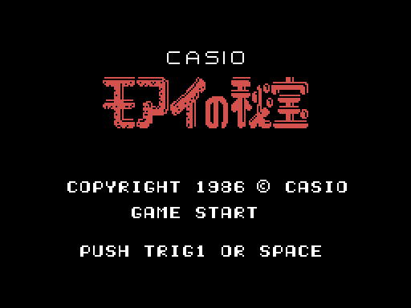
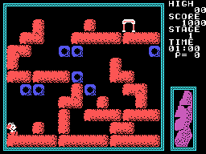
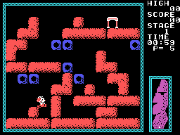
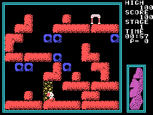

# The game

*Moai no Hihou* (モアイの秘宝, "The treasure of the moai") is a maze game seen from the side. Each stage is a screen of
rocks and blocks with the exit, a door, at the top; the hero has to reach it before time runs out, breaking rocks
with blows and laying blocks to climb. The 32 stages, in [The stages](THE-STAGES.html).

Every GIF on this site is the ROM **running in openMSX** (a Japanese MSX1 with C-BIOS, at 60 frames per second): on
every frame the VRAM, the RAM and the VDP registers are logged, and `tools/vdp.py` paints them. The game ones are
simple pilots written for the purpose (`tools/guiones/`).

## The intro and the title

Two CASIO come in from the sides and, from step 9, two more go down and up until they meet; at step 21, a short tune
and SOFTWARE underneath (`presentacion`, 0xABEC). The title is built in RAM (0xE700) and copied whole to the screen:
CASIO, the name, the copyright, GAME START and PUSH TRIG1 OR SPACE (`titulo_ram`, 0x8267). Below, off the screen,
are the credits: after 128 frames they scroll up, one row every 16 frames, and then the **demo** starts, which plays
the first stage from a list of controls (0x5700).

## The controls

| | joystick | keyboard |
|---|---|---|
| walk | joystick 1 | the cursors |
| strike | button 1 | the space bar |
| jump | button 2 | GRAPH |
| lay a block | down | down |

**The blow** breaks the rock in front, at the height of the feet or the head (`prota_golpe`, 0x9F74). The rocks are
made of pieces that fit together: the blow breaks the piece and the ones joined to it (`rompe`), and whatever was on
top falls. **Down** lays one of his blocks (tile 0x88 gives them, see [The stages](THE-STAGES.html)) on the map spot
where he stands, if it is empty and has something below (`prota_bloque`, 0x9EC9). **Up** does nothing: the code that
picked up a laid block (0x9F1A) is never called.

A rock that falls on top **crushes**: every frame the game checks whether there is a piece of rock (tiles
0x30-0x37) on the row of the hero's head (`aplastado`, 0x8AEA). That is how most lives are lost.

## The time

TIME starts at one minute in the first stage and reaches fifteen in the last ones; the BONUS GAMEs have 20 to 35
seconds (the table at 0x85B5). It counts one second every 64 frames (`tiempo`). At zero, the hero loses a life.

## The lives

The game starts with **five** (P= 5 on the scoreboard). One is lost by being crushed, touched by an enemy, with the
time at zero or with F1. There are no extra lives. With none left, GAME OVER and the title.

## The points

The scoreboard paints the six digits of the score as they are (other Casio games have a fixed 0 after them; here
there was meant to be one, see [Curiosities](CURIOSITIES.html)).

| | points |
|---|---:|
| a broken piece of rock | 20 |
| tile 0x80 | 25 |
| tile 0x84 | 30 |
| tile 0x88 | 40 |
| tile 0x8C (a jewel) | 100 |
| finishing a stage | 1,000 to 24,000 |
| each jewel taken in a BONUS GAME | 100 more |

The prize for each stage comes from the table at 0x40B5: 1,000 for the first, 2,000 for the second... up to 24,000.
