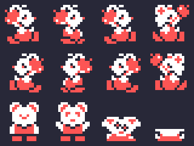
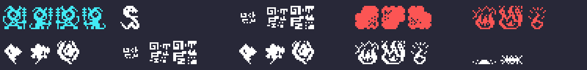

# The sprites

Everything on this page is **put together from the ROM tables** with `tools/hojas.py`: the drawings are the 0x800
bytes at 0x5800 that `sprites_dibujos` (0xAE17) puts as they are at 0x3800, and every figure is built with the
drawings and colours its own routine gives it. The hero is two sprites at 0xE100 and 0xE110 (16 bytes each; the
first 4, its attributes), and the things on the map, twelve 16-byte slots from 0xE120 (+4, the type with bit 7).
None of these images is a screenshot.

**Checked against openMSX** on the recordings of this site:

- the sprite drawing table (VRAM 0x3800-0x3FFF) is **identical** to the game's on 82,937 frames (6 more catch the
  copy halfway);
- the hero's two sprites match on 57,403 frames (25,099 more have no colour: not placed yet, or out of view while
  looking up and down); on **215** the drawing is a number that is none of his poses (0x7E, 0xCD, 0xFD...) with the
  second sprite still + 4: unexplained;
- the things on the map have a drawing and a colour of their type on **21,879 frames, 0 different**.

## The hero

Two sprites in the same place: the drawing in white and the drawing + 4 in red. Top row, with bit 4 of +4 clear:
standing 0x00, walking 0x00 and 0x08 every 4 frames (`prota_paso`, 0xA612), jumping 0x20 (`salto`, 0xA879) and
punching 0x08 and then 0x30 (the table at 0xA5F2, a step every 2 frames). Second row, the other way: + 0x10 standing
and walking (`prota_quieto`, 0x9E85) and + 8 jumping and punching. Below, waiting a long time, 0x58 and then 0x50
(0x9E76), and dying, 0x40 and 0x48 (the table at 0x8A91, a drawing every 8 frames):

## The things on the map

One sprite each. Type 1 (`andarin`: 0x80 in cyan, + 8 the other way and + 4 the step every 16 frames,
`dibujo_lado` 0x9983) and type 2 (`rodador`: 0x98, white); the others change drawing among three, 4 apart
(`dibujo_anima`, 0x999F): type 3 (`volador`: 0xA8, white), type 4 (0xC8, red), type 5 (`laberinto`: 0xE0), type 6
(`rodante`: 0xEC, white), type 8 (`parpadea`: 0xA8, blinking white and light blue every 4 frames, 0x9972), type 9
(`recto`: 0xEC) and type 10 (`giros`: 0xE0); and type 7, the explosion (0xF8 and + 4 every 16 frames):

The hero walking, punching and dying, with two of the things, at the game's pace:

