# The stages

There are **32**: 24 numbered ones (STAGE 1 to 24 on the scoreboard) and, every fourth, a **BONUS GAME** (stages 3,
7, 11... of the game; `fase_numero`, 0x851E). Each one is 12 blocks of 2 x 2 tiles wide, built in RAM (0xE800) from
its map (`fase_monta`, 0x849D); the screen shows 11 rows and, when the hero reaches the very top or bottom, the view
goes up or down (`vista_sube`, 0x8956). The rocks change colour every four stages (0x864E). On the right, the
scoreboard: HIGH, SCORE, STAGE, TIME, P= the lives and, below, a moai with a mark that blinks where the hero is
(`prota_cara`, 0x403B).

The stage GIFs come from a **forced recording**: the game pilot plays each stage for a while and then
`tools/guiones/forzada.tcl` ends it with a poke (0xE03A = 1, the exit; in the BONUS, 0xE183 = 1).

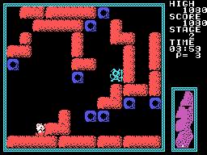

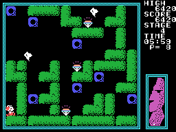

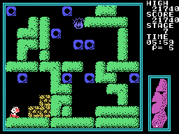

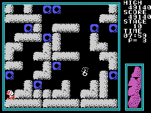

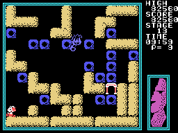

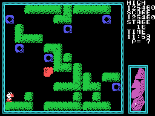

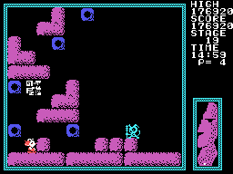

## What can be picked up

Things are picked up by stepping on them: the game reads the tile under the hero (`prota_pisa`, 0xA6BF).

| tile | what it does | points |
|---|---|---:|
| 0x80 | two protections (0xE30F) against enemies of types 1, 2 and 5: each touch uses one; with six or more, the jump is higher | 25 |
| 0x84 | protects for good from types 3 and 6 (0xE30C) | 30 |
| 0x88 | two blocks to lay | 40 |
| 0x8C | a jewel (0xE30D) | 100 |
| 0x90 | the exit: the stage is over | |

What he carries is drawn on the scoreboard, under P=.

## The stage over

On reaching the door, the prize screen: three moai on the grass, YOU GET BONUS and the stage points
(`fase_siguiente`, 0x8B9E); the hero crosses it from left to right with the stage-over tune (`fase_cruza`, 0x8C20),
and the next one starts.

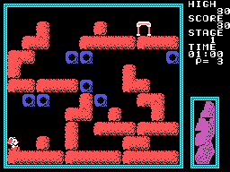

## The BONUS GAME

Some platforms with jewels and 20 to 35 seconds. It ends with the time or on touching something: in the BONUS,
whatever would cost a life in another stage ends it (`fase_bucle_fin`, 0x88FF). At the end, YOU GET BONUS, the
jewels taken and 100 points for each.

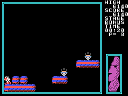

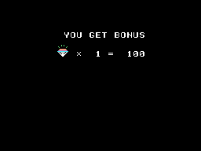

## The enemies

There are five at a time (0xE120, 16 bytes each); they come out of the map as each row is painted (`fila_bloques`,
0x9C66) and each type has its routine (the table at 0x931E).

| type | how it moves |
|---|---|
| 1 | walks looking at the six tiles around it: goes on, turns back, jumps a step or falls (`andarin`, 0x9334) |
| 2 | rolls: one step every 8 frames and falls if there is no floor (`rodador`, 0x9505) |
| 3 | flies straight, one step every 16 frames, without falling (`volador`, 0x9572) |
| 4 | walks changing its drawing and falls if there is no floor (0x95BF) |
| 5 | follows the wall along the passages (`laberinto`, 0x966A) |
| 6 | goes back and forth, across or up and down (`rodante`, 0x978E) |
| 8 | blinks and, after 128 times, explodes (`parpadea`, 0x97DB) |
| 9 | goes straight for some steps and explodes (`recto`, 0x981A) |
| 10 | follows a path of stretches and explodes (`giros`, 0x9857) |

Type 7 is the explosion. A rock that falls on an enemy makes it explode and gives points (see
[Curiosities](CURIOSITIES.html)).

## The ending

After stage 32 (the last BONUS), the moai screen again, with the ending tune: the hero crosses it and, as he
passes, each moai turns into a heap of jewels (0x412B). PJM1622 appears at the top and the colours cycle, with the
tune over and over, until the button is pressed: the title.

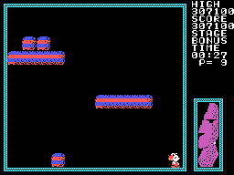
