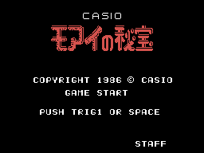
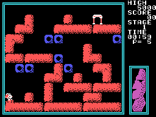
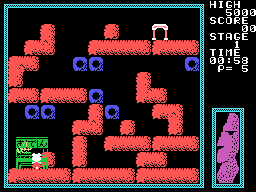

# Curiosidades

## El selector de fase

Al empezar la partida, el juego mira el teclado (`fase_empieza`, 0x82FD): con **dos teclas** pulsadas se empieza en
otra fase. La A o la B con el 0 o el 5 dan las fases 0, 5, 12 y 18 (la A con el 0, la primera; la B con el 5, la
18); la Z, la Y, la X, la W o la V con una letra de la C a la R eligen en la tabla de 0x83B9. Grabado en openMSX: con
la B y el 5 pulsadas al pulsar la barra, la partida empieza en la fase 18 del juego, que el marcador llama STAGE 15
(los BONUS no se cuentan).

## SELECT y ESC en el título

Con **SELECT** pulsada en el título (0xE023 = 1), ni las rocas, ni los enemigos, ni el tiempo quitan vidas; F1 sí
(`tocado`, 0x899E). El código deja pasar un caso, el 0x80 en 0xE183, pero nadie escribe nunca ese valor: solo 0xFF,
1 y 0.

Con **ESC** (`titulo`, 0x80BC), el récord pasa a 5000 (0xE032 = 0x50) y 0xE039 a 2; ese 0xE039 no lo lee nadie. En
otros cartuchos de Casio de la misma época, la misma tecla en el mismo sitio sirve para continuar.

## STOP para mirar

Mientras se tiene **STOP** pulsada, el juego se para y deja mirar: un marco rodea al protagonista y la palanca sube
y baja la vista (`mirar`, 0x8778); al soltarla, la vista vuelve sola a su sitio (`mirar_vuelve`). **F1** quita una
vida (`muere`, 0x89B2).

## Al marcador le falta un texto

El marcador pinta HIGH, SCORE y STAGE con la misma rutina (`marcador_pon`, 0x928D); después iba un texto de seis
casillas, "     0", en la fila de los puntos (0x92DF), que en otros juegos de Casio es el 0 fijo de detrás de las
cifras. Pero la instrucción que debía apuntar DE a él carga HL (`ld hl,092dfh`, 0x92AB), así que se escribe desde el
0xFF en el que acabó STAGE: nada. Los puntos salen sin el 0 de detrás.

## Los puntos de los enemigos aplastados

Una roca que cae encima de un enemigo lo hace explotar y da los puntos de su tipo de la tabla de 0x99F3 (500, 300,
300, 100, 100, 100). Pero el tipo se lee con el bit 7 puesto (lo ponen todas las rutinas al arrancar), así que el
juego no lee la tabla sino los bytes de 0x9A74 a 0x9A7D, que son código (`aplastado_objeto`, 0x99CE). Lo dice el
código; en las grabaciones de esta web ningún enemigo murió aplastado, así que no lo hemos visto en pantalla.

## Textos sin usar

- **GOOD LUCK TO NEXT STAGE** (0x8D63), detrás de los textos de la fase acabada: ninguna llamada lo escribe.
- **FLOOR** (0x92E6), entre los del marcador: tampoco.
- **PUSH TR1 TO START** (0x8619) va pegado a P=, y la rutina para antes de llegar a él.
- El nombre del título está dos veces (0x543D y 0x547D), la segunda con las casillas en otro orden; solo se lee la
  primera.

## Código que nadie llama

- Arriba no hace nada: la rutina que recogía un bloque puesto (0x9F1A) se quedó sin llamada.
- En 0xAFA7, la interrupción salta por encima de un trozo que repartía un botón de la demostración entre dos
  variables (0xE020 y 0xE022).
- `espera_256` (0xAE31) prepara HL = 0xE000 y BC = 0xF00, como para borrar la RAM, pero el bucle solo cuenta 256
  vueltas: es una espera.
