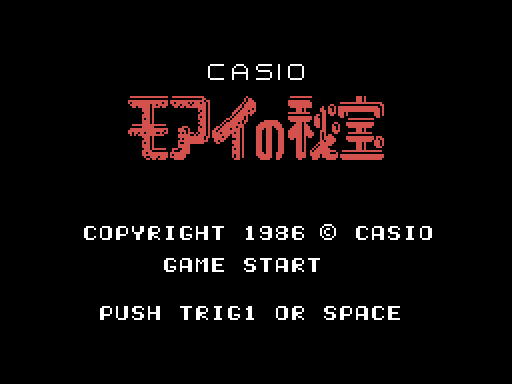
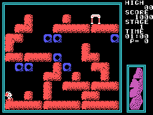
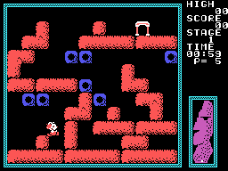
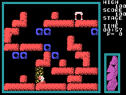

# La partida

*Moai no Hihou* (モアイの秘宝, "El tesoro de los moai") es un juego de laberintos visto de lado. Cada fase es una
pantalla de rocas y bloques con la salida, una puerta, arriba; el protagonista tiene que llegar a ella antes de que se
acabe el tiempo, rompiendo rocas a golpes y poniendo bloques para subir. Las 32 fases, en [Las fases](LAS-FASES.html).

Todos los GIF de esta web son la ROM **funcionando en openMSX** (un MSX1 japonés con C-BIOS, a 60 cuadros por
segundo): en cada cuadro se apuntan la VRAM, la RAM y los registros del VDP, y `tools/vdp.py` los pinta. Los de la
partida son pilotos sencillos escritos para ello (`tools/guiones/`).

## La presentación y el título

Dos CASIO entran por los lados y, desde el paso 9, otros dos bajan y suben hasta juntarse; con el paso 21, una
música corta y SOFTWARE debajo (`presentacion`, 0xABEC). El título se monta en la RAM (0xE700) y se copia entero a
la pantalla: CASIO, el nombre, el copyright, GAME START y PUSH TRIG1 OR SPACE (`titulo_ram`, 0x8267). Debajo,
fuera de la pantalla, están los créditos: a los 128 cuadros suben, una fila cada 16 cuadros, y después empieza la
**demostración**, que juega la primera fase con una lista de mandos (0x5700).

## Los mandos

| | mando | teclado |
|---|---|---|
| andar | el mando 1 | los cursores |
| golpear | el botón 1 | la barra |
| saltar | el botón 2 | GRAPH |
| poner un bloque | abajo | abajo |

**El golpe** rompe la roca que tiene delante, a la altura de los pies o de la cabeza (`prota_golpe`, 0x9F74). Las
rocas están hechas de piezas que encajan: el golpe rompe la pieza y las que están unidas a ella (`rompe`), y lo que
tenían encima cae. **Abajo** pone uno de sus bloques (los da la casilla 0x88, ver [Las fases](LAS-FASES.html)) en el
sitio del mapa donde está, si está vacío y tiene algo debajo (`prota_bloque`, 0x9EC9). **Arriba** no hace nada:
el código que recogía un bloque puesto (0x9F1A) no lo llama nadie.

Una roca que cae encima **aplasta**: el juego mira, cada cuadro, si en la fila de la cabeza del protagonista hay una
pieza de roca (las casillas 0x30-0x37, `aplastado`, 0x8AEA). Así se pierden casi todas las vidas.

## El tiempo

TIME empieza en un minuto en la primera fase y llega a quince en las últimas; los BONUS GAME tienen de 20 a 35
segundos (la tabla de 0x85B5). Cuenta un segundo cada 64 cuadros (`tiempo`). A cero, el protagonista pierde una vida.

## Las vidas

La partida empieza con **cinco** (P= 5 en el marcador). Se pierde una aplastado, tocado por un enemigo, con el tiempo
a cero o con F1. No hay vidas extra. Sin vidas, GAME OVER y el título.

## Los puntos

El marcador pinta las seis cifras de los puntos tal cual (en otros juegos de Casio hay un 0 fijo detrás; aquí iba a
haberlo, ver [Curiosidades](CURIOSIDADES.html)).

| | puntos |
|---|---:|
| una pieza de roca rota | 20 |
| la casilla 0x80 | 25 |
| la casilla 0x84 | 30 |
| la casilla 0x88 | 40 |
| la casilla 0x8C (una joya) | 100 |
| acabar una fase | de 1.000 a 24.000 |
| cada joya cogida en un BONUS GAME | 100 más |

El premio de cada fase sale de la tabla de 0x40B5: 1.000 por la primera, 2.000 por la segunda... hasta 24.000.
