# Las fases

Son **32**: 24 numeradas (STAGE 1 a 24 en el marcador) y, cada cuarta, un **BONUS GAME** (las fases 3, 7, 11...
del juego; `fase_numero`, 0x851E). Cada una tiene 12 bloques de 2 x 2 casillas de ancho, montados en la RAM
(0xE800) desde su mapa (`fase_monta`, 0x849D); la pantalla enseña 11 filas y, cuando el protagonista llega arriba o
abajo del todo, la vista sube o baja (`vista_sube`, 0x8956). Las rocas cambian de color cada cuatro fases (0x864E). A la derecha, el marcador: HIGH, SCORE, STAGE, TIME, P= las vidas y, debajo, un moai con una marca que
parpadea donde está el protagonista (`prota_cara`, 0x403B).

Los GIF de las fases son de una **grabación forzada**: el piloto de la partida juega cada fase un rato y después
`tools/guiones/forzada.tcl` la da por acabada con un poke (0xE03A = 1, la salida; en el BONUS, 0xE183 = 1).

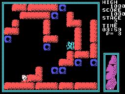

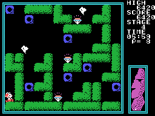

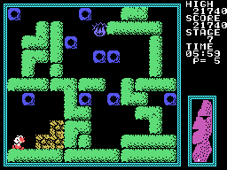

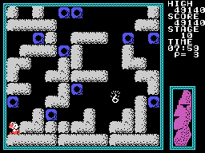

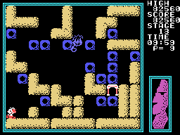

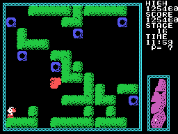

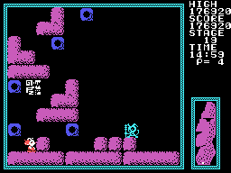

## Los mapas

Las 32 fases enteras, de abajo arriba como las monta el juego, a la mitad de tamaño y ocho por imagen. Están
**pintadas ejecutando la ROM** (`tools/mapas.py`): `fase_monta` (0x849D) deja el mapa de la fase en la RAM (0xE800,
filas de 12 bloques de 2 x 2 casillas) con lo que se coge ya puesto, y `mapa_pinta` (0x8D7B) lo pinta de 11 en 11
filas, como hace al subir o bajar la vista. Los dibujos y colores de las casillas, que el juego carga al empezar y
cada cuatro fases (0x864E), salen de un cuadro grabado de cada fase. Sin marcador ni sprites: los enemigos y los
objetos que se mueven no están.

Cotejo con la grabación forzada: en cada cuadro de juego, la tabla de nombres contra lo montado desde la fila que
enseña la vista (0xE369): de 59.707 cuadros, 30.382 salen **iguales** y la mediana es 0 casillas distintas de 528.
Los otros llevan lo que el juego cambia en la pantalla durante la partida (rocas que caen, bloques que se ponen) y
los cuadros de los cambios de fase.

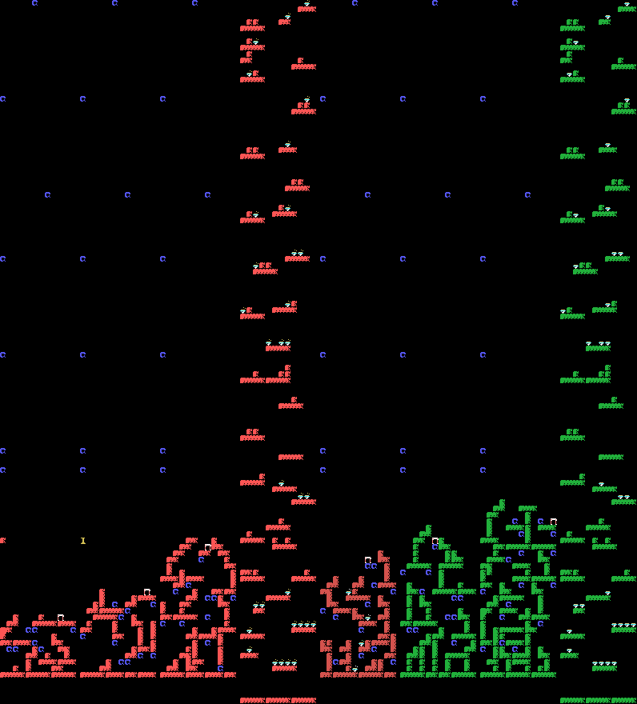

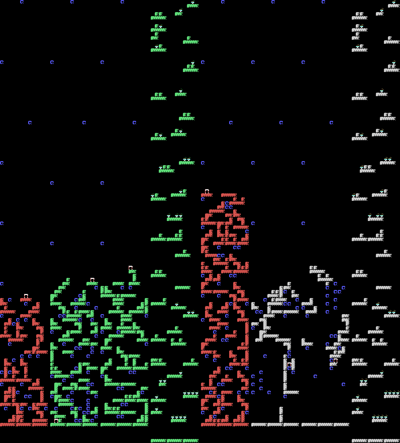

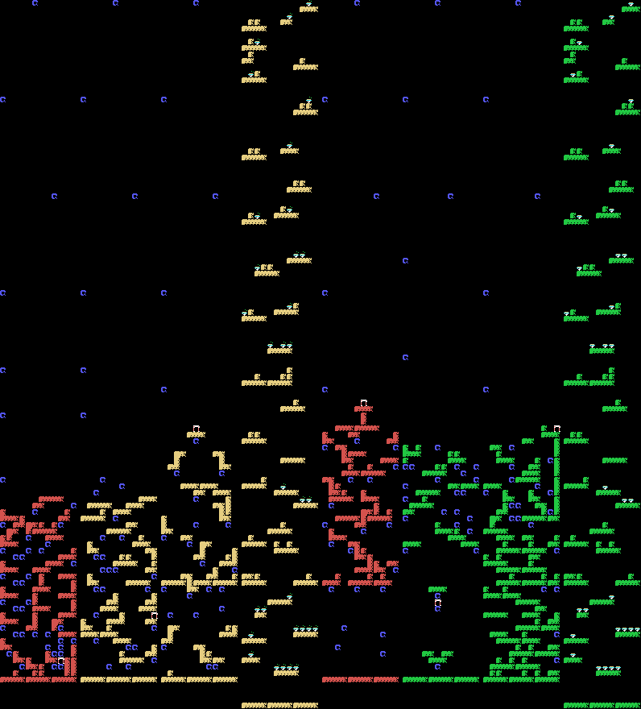

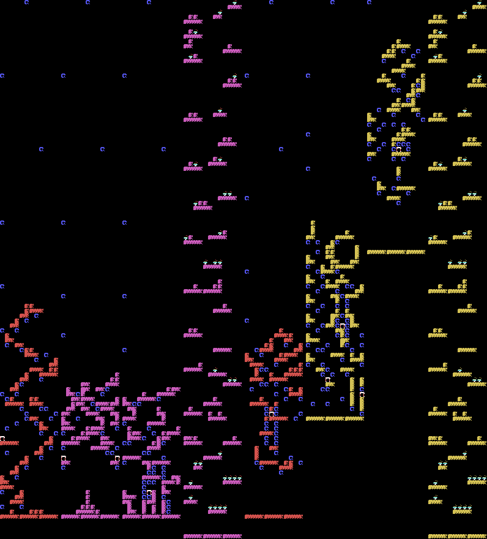

## Lo que se coge

Se coge pisándolo: el juego lee la casilla que hay debajo del protagonista (`prota_pisa`, 0xA6BF).

| casilla | qué hace | puntos |
|---|---|---:|
| 0x80 | dos protecciones (0xE30F) contra los enemigos de los tipos 1, 2 y 5: cada toque gasta una; con seis o más, el salto es más alto | 25 |
| 0x84 | protege para siempre de los tipos 3 y 6 (0xE30C) | 30 |
| 0x88 | dos bloques para poner | 40 |
| 0x8C | una joya (0xE30D) | 100 |
| 0x90 | la salida: la fase acabada | |

Lo que se lleva sale dibujado en el marcador, debajo de P=.

## La fase acabada

Al llegar a la puerta, la pantalla del premio: tres moai sobre la hierba, YOU GET BONUS y los puntos de la fase
(`fase_siguiente`, 0x8B9E); el protagonista la cruza de izquierda a derecha con la música de la fase acabada
(`fase_cruza`, 0x8C20), y empieza la siguiente.

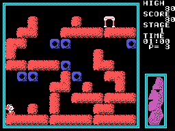

## El BONUS GAME

Unas plataformas con joyas y de 20 a 35 segundos. Acaba con el tiempo o al tocar algo: en el BONUS, lo que en otra
fase quita una vida, la da por acabada (`fase_bucle_fin`, 0x88FF). Al final, YOU GET BONUS, las joyas cogidas y 100
puntos por cada una.

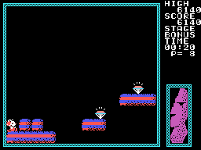

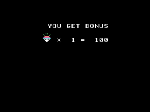

## Los enemigos

Hay cinco a la vez (0xE120, 16 bytes cada uno); salen del mapa al pintar cada fila (`fila_bloques`, 0x9C66) y
cada tipo tiene su rutina (la tabla de 0x931E).

| tipo | cómo se mueve |
|---|---|
| 1 | anda mirando las seis casillas de alrededor: sigue, da la vuelta, salta un escalón o cae (`andarin`, 0x9334) |
| 2 | rueda: un paso cada 8 cuadros y cae si no hay suelo (`rodador`, 0x9505) |
| 3 | vuela recto, un paso cada 16 cuadros, sin caer (`volador`, 0x9572) |
| 4 | anda cambiando de dibujo y cae si no hay suelo (0x95BF) |
| 5 | sigue la pared por los pasillos (`laberinto`, 0x966A) |
| 6 | va y vuelve, a lo ancho o a lo alto (`rodante`, 0x978E) |
| 8 | parpadea y, a las 128 veces, explota (`parpadea`, 0x97DB) |
| 9 | va recto unos pasos y explota (`recto`, 0x981A) |
| 10 | sigue un recorrido de tramos y explota (`giros`, 0x9857) |

El tipo 7 es la explosión. Una roca que cae encima de un enemigo lo hace explotar y da puntos (ver
[Curiosidades](CURIOSIDADES.html)).

## El final

Después de la fase 32 (el último BONUS), la pantalla de los moai otra vez, con la música del final: el protagonista
la cruza y, a su paso, cada moai se cambia por un montón de joyas (0x412B). Arriba sale PJM1622 y los colores giran,
con la música una y otra vez, hasta que se pulsa el botón: el título.

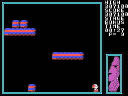
