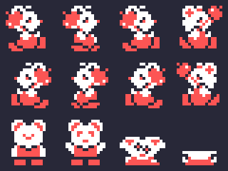
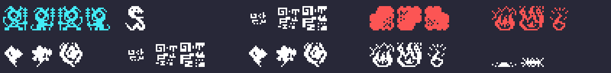

# Los sprites

Todo lo de esta página está **montado desde las tablas de la ROM** con `tools/hojas.py`: los dibujos son los 0x800
bytes de 0x5800 que `sprites_dibujos` (0xAE17) pone tal cual en 0x3800, y cada figura se arma con los dibujos y los
colores que le da su propia rutina. El protagonista son dos sprites en 0xE100 y 0xE110 (16 bytes cada uno; los 4
primeros, sus atributos), y las cosas del mapa, doce huecos de 16 bytes desde 0xE120 (+4, el tipo con el bit 7).
Ninguna de estas imágenes es una captura.

**Cotejado con openMSX** en las grabaciones de esta web:

- la tabla de dibujos de los sprites (VRAM 0x3800-0x3FFF) es **idéntica** a la del juego en 82.937 cuadros (otros 6
  pillan la copia a medias);
- los dos sprites del protagonista casan en 57.403 cuadros (otros 25.099 no tienen color: aún sin poner, o fuera de
  la vista al mirar arriba y abajo); en **215** el dibujo es un número que no es ninguna de sus posturas (0x7E,
  0xCD, 0xFD...) con el segundo sprite aún + 4: sin explicar;
- las cosas del mapa llevan un dibujo y un color de su tipo en **21.879 cuadros, 0 distintos**.

## El protagonista

Dos sprites en el mismo sitio: el dibujo en blanco y el dibujo + 4 en rojo. Arriba, con el bit 4 de +4 a cero: de
pie 0x00, andando 0x00 y 0x08 cada 4 cuadros (`prota_paso`, 0xA612), saltando 0x20 (`salto`, 0xA879) y dando el golpe
0x08 y después 0x30 (la tabla de 0xA5F2, un paso cada 2 cuadros). En la segunda fila, al otro lado: + 0x10 de pie y
andando (`prota_quieto`, 0x9E85) y + 8 saltando y golpeando. Abajo, esperando mucho rato, 0x58 y después 0x50
(0x9E76), y muriendo, 0x40 y 0x48 (la tabla de 0x8A91, un dibujo cada 8 cuadros):

## Las cosas del mapa

Un sprite cada una. El tipo 1 (`andarin`: 0x80 en cian, + 8 hacia el otro lado y + 4 el paso cada 16 cuadros,
`dibujo_lado` 0x9983) y el 2 (`rodador`: 0x98, blanco); los demás cambian de dibujo entre tres, de 4 en 4
(`dibujo_anima`, 0x999F): el 3 (`volador`: 0xA8, blanco), el 4 (0xC8, rojo), el 5 (`laberinto`: 0xE0), el 6
(`rodante`: 0xEC, blanco), el 8 (`parpadea`: 0xA8, parpadeando en blanco y azul claro cada 4 cuadros, 0x9972), el 9
(`recto`: 0xEC) y el 10 (`giros`: 0xE0); y el 7, la explosión (0xF8 y + 4 cada 16 cuadros):

El protagonista andando, golpeando y muriendo, con dos de las cosas, al ritmo del juego:

